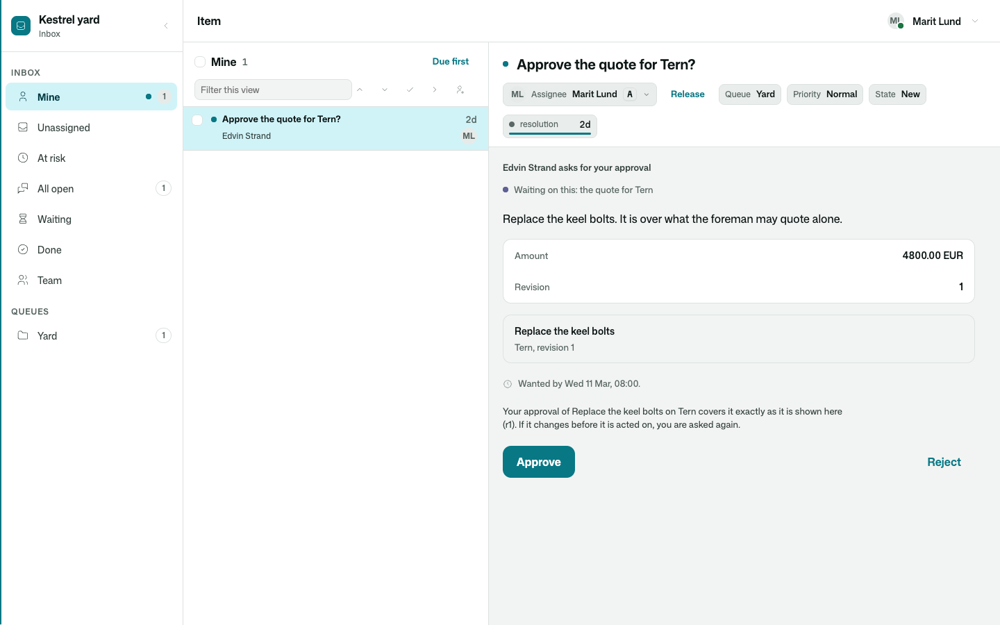
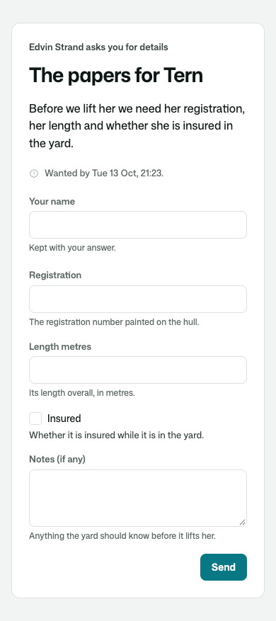
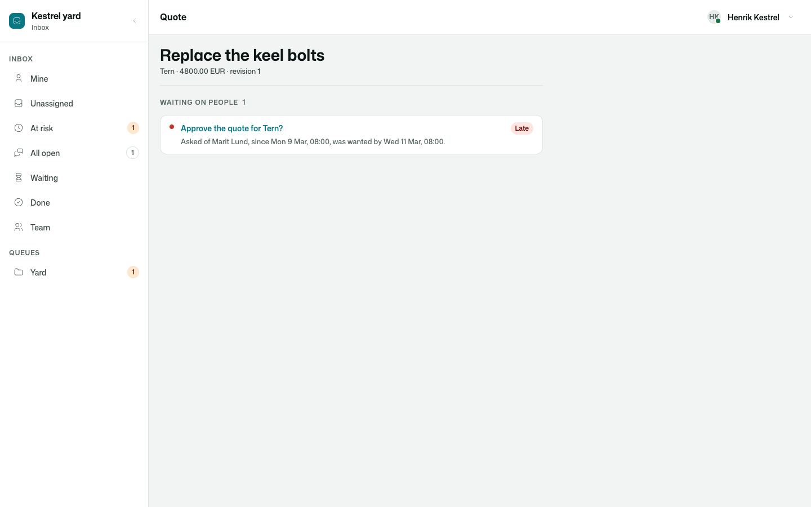

# Osysharp.HumanRequests

Put something to a person, and get their answer back, however long it takes.

A question with the options it may be answered with. An approval of one exact version of a thing. A form whose
fields are the members of a class you declare. Asked by a person, a process or an agent; answered in the inbox your
team already works, or — by somebody with no account — through a link that opens that one request.

```osy
use Osysharp.HumanRequests@1;

var request = PutRequest(new NewRequest {
  Kind = RequestKind.Approval, To = manager, Title = "Approve the quote for Tern?",
  Context = "Replace the keel bolts. It is over what the foreman may quote alone.",
  Facts = [new RequestFact("Amount", "4800.00 EUR")],
  About = Subject.Of("Quote", quote.Id, "Replace the keel bolts on Tern", version: "r" + quote.Revision),
  Within = TimeSpan.FromHours(16), Hours = yardHours, RemindAfter = TimeSpan.FromHours(4), EscalateTo = owner,
});

var answer = await Requests.Answer(request);       // in a workflow: parks here, for days if it takes days
if (answer.Approved) {
  UseApproval(request, "r" + quote.Revision);       // refused if the quote changed after the yes
  Send(quote);
}
```



## Use case

Work stops at people. A quote over somebody's limit needs a manager's yes. A process cannot go on until the foreman
says which slip. A supplier has to send the details only they have, and they will never have an account. Built by
hand, each of these is a status column, a mail somebody forgets to chase, and an "approved" flag that still says
approved after the thing it approved was changed.

- **The answer comes back to what waits.** A workflow writes `await Requests.Answer(request)` and is parked — costing
  nothing, asking nothing of anybody — until the answer is in, a month later if need be. A page hears an event.
- **An approval is of one exact version, used once.** It is put with the version that was shown; the act it allows
  names the version as it is now. Changed since? Refused, and asked again.
- **A form is a class.** `NewRequest.For<BoatPapers>()` asks for its members: a name in words for a label, the
  member's `///` comment under it, the type deciding the field. What comes back is a `BoatPapers`.
- **One inbox.** A request is an item of `Osysharp.WorkQueues`: its queue, its holder, its promises. The person it
  is put to has it as it arrives.
- **No account needed.** A link opens the one request it was made for and nothing else. The answer is kept with the
  name they gave and how they were known: by holding the link.
- **Time in working hours.** Late after sixteen working hours means Wednesday morning, not Tuesday at one a.m.
  Reminders stop at their limit.
- **Late is not closed, and silence decides nothing.** An overdue request says so, goes on to the next person, and
  still waits. An approval nobody gave is not an approval.
- **Too late is kept, never applied.** An answer that arrives after the request was answered, called off or ran out
  of time is stored beside it and changes nothing.
- **Four eyes.** Whoever asked cannot answer their own request.



## What it does

| | |
|---|---|
| **Asking** | `PutRequest(new NewRequest { Kind, Title, Context, Facts, To / Queue / OutsideEmail, Options, Fields, About, WaitingWork, Within, ExpireAfter, Hours, RemindAfter, RemindEvery, MaxReminders, EscalateTo })`. `NewRequest.For<T>()` asks for the members of a class. Who asked is read from who is signed in; a process asks as the app. |
| **Waiting** | `await Requests.Answer(request)` in a workflow · `OutcomeOf(request)` any time · the events `HumanRequestAnswered`, `HumanRequestCancelled`, `HumanRequestExpired`. `RequestOutcome` — `Status`, `Choice`, `Comment`, `Approved`, `Rejected`, `ByName`, `With`, `As<T>()`. |
| **Answering** | `AnswerRequest(request, RequestAnswer.Approve() / .Reject(why) / .Choose(key) / .Say(words) / .Of(details))` as whoever is signed in. `AnswerByLink(link, answer, name)` through the link. Checked against what was asked; a no says why. |
| **Somebody outside** | `AnswerLinkFor(request)` — the link's text, for the mail the app sends · `RevokeAnswerLink(request)` · the page `ExternalAnswer(link)`. |
| **Approvals** | `UseApproval(request, versionNow)` — once, for the version approved (`ApprovalNoLongerApplies` otherwise) · `ApprovalCovers(request, versionNow)` · `ReplaceRequest(old, ask, why)` asks again about the thing as it is now. |
| **Time** | Late at `Within`, counted in `Hours`; reminders in the same hours, up to `MaxReminders`; `EscalateTo` when late; gives up at `ExpireAfter` only when one is said. `ExtendRequest(request, within, why)` · `CancelRequest(request, why)`. Events `HumanRequestReminded`, `HumanRequestOverdue`, `HumanRequestRetimed`. |
| **Too late** | `LateAnswer` rows — kept, with who and how they were known — and `HumanRequestAnsweredLate`. |
| **Lists** | `Requests.Mine()` · `Requests.WaitedOnBy(type, id)` · `Requests.PutBy(name)`. |
| **Screens** | `RequestSheet(id)` — drawn for you on the inbox's item · `ExternalAnswer(link)` · `WaitingOnPeople(waitingType:, waitingId:)` · "Approve all" on the inbox's bulk bar · the slot `RequestSubject` for whoever owns what a request is about. |

## The app says two things

```osy
policy AsksPeople       => IsStaff;      // who may put a request to a person
policy OverseesRequests => IsLead;       // who reads every request, calls one off, gives it more time
```

Each is nobody's until the app says. The inbox's own three (`WorksInbox`, `LeadsInbox`, `AdministersInbox`) decide
who works its queues. Sending — the mail with a link, the nudge of a reminder — is the app's: an `[On]` handler on
`HumanRequestPut` and `HumanRequestReminded`, with whatever it already sends with.



## Tests

`tests/` is a boatyard: a quote that needs the manager's approval of that exact revision, a question to the
foreman, a boat's owner asked for her papers through a link. 37 tests — putting and answering, the process that
waits thirty days, approvals and versions, time in working hours, links and late answers, who may do what, and the
screens driven as a person (`osy test --pixels` photographs them wide and on a phone, light and dark).

## Source and package

- Source: [`kits/human-requests`](.) — Osy#, readable and forkable.
- Package: `Osysharp.HumanRequests` · needs `Osysharp.WorkQueues`, `Osysharp.Identity`, `Osysharp.Workflow`,
  `Osysharp.ServiceHours`, `Osysharp.Ui`.
- Reference: `osy docs agent-human-requests`.
