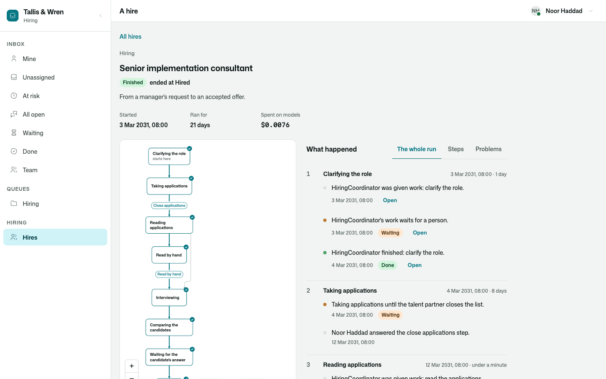

# Osysharp.HumanRequests.Processes

What a business process asks of people — told on the process's own run.

```osy
use Osysharp.HumanRequests@1;
use Osysharp.Processes@1;         // …and this bridge is there: nothing to wire.

workflow Hiring {
  Tracks = Hire.Stage; Initial = Interviewing;
  state Interviewing {
    enter {
      var ask = Workflow.Once("ask-feedback", () => PutRequest(feedbackForm));
      var answer = await Requests.Answer(ask);        // the run waits here, however long the person takes
      if (!answer.Answered) { goto NoHire; }           // nobody answered, or it was called off
      goto Comparing;
    }
  }
  …
}
```



## Use case

A consultancy fills a role. The hiring manager is asked what her request left open; three candidates, who have no
account, are each sent a link and asked when they could meet; two interviewers are asked for their feedback on a
form; the candidate who is chosen says yes or no to the offer. The hire is a process, and most of its steps wait
for a person. Without this bridge the page of that run says, for each of those steps, that nothing was recorded.

With it:

- **A request put from a run is a line of that run**, in the state that put it: *Asked Emil Brandt: "Your feedback
  on Petra Olin"* — or *Asked Petra Olin, by a link* for somebody outside, or the queue it waits in.
- **What became of it is a line too.** Who answered, or approved, or refused, and after how long. That its date
  passed and whom it went on to. That nobody answered before it ran out of time. That it was called off, and why.
- **The line opens the request in place**, as whoever is looking may read it: what was asked, what came back, when.
- **Nothing is written at the call.** The request records the run it was put in by itself
  (`HumanRequest.Run`, `RunState`); a request put outside any run is told on none.
- **Who reads what is decided where it always was**: the run by `FollowsProcesses` and the app's rules for the row
  it is about; the request by `Osysharp.HumanRequests`' own rules. Somebody who follows the run and may not read a
  request sees the line, and is told the request is not theirs when they open it.


## What it adds

| | |
|---|---|
| A line on the run when a request is put, passes its date, is answered, runs out of time or is called off | by itself — the bridge hears `HumanRequestPut`, `HumanRequestOverdue`, `HumanRequestAnswered`, `HumanRequestExpired`, `HumanRequestCancelled` |
| The request, opened in place on the run's page | a contribution to `ProcessMomentPanel` |
| `RequestSubject()` | what a run's line about a request is marked as, for an app that draws its own |
| Lines told again without the person, when a request is erased | by itself — the bridge hears `HumanRequestErased` |

A request an agent puts — a proposal to decide, a question it asks — is told by the agent's own work on the run
([`Osysharp.Agents.Processes`](../agents-processes)), once.

## Its tests

`kits/human-requests-processes/tests` is Tallis & Wren hiring a senior implementation consultant, walked from the
manager's request to an accepted offer over three weeks: an agent asks the manager what her request leaves open;
four applications are read by a second agent, one of them by hand when the agent's allowance runs out; three
candidates are asked through links; one withdraws and is erased; an interviewer's request goes on to a colleague;
the manager refuses the first offer the agent proposes and approves the second; the candidate accepts. The one
model is scripted. No model is ever called.

| | |
|---|---|
| The whole hire, day by day | `a_hire_is_carried_from_the_managers_request_to_an_accepted_offer` |
| The run tells whom it asked and who answered, in each state | `the_run_of_a_hire_tells_whom_it_asked_and_who_answered_in_each_state` |
| Each reader sees what is theirs | `each_reader_of_a_hire_sees_what_is_theirs` |
| On screen: the manager's inbox, the run with a request opened in place, a piece of the agents' work — wide and on a phone, light and dark | three tests in `hire-ui.test.osy` |
| A person who is erased is gone from the request put to them, and from the run's lines about it | `a_candidate_who_is_erased_is_gone_from_what_was_asked_of_him_too` |

```
osy test kits/human-requests-processes/tests            # 7 tests
osy test kits/human-requests-processes/tests --pixels   # the same in a real browser, photographed
```

## Source and package

- Package: `Osysharp.HumanRequests.Processes` — arrives by itself in an app that uses both
  `Osysharp.HumanRequests@1` and `Osysharp.Processes@1`
- Source: [`kits/human-requests-processes`](.) — `model/Bridge.osy`
- Uses [`Osysharp.HumanRequests`](../human-requests), [`Osysharp.Processes`](../processes) and `Osysharp.Ui`.
